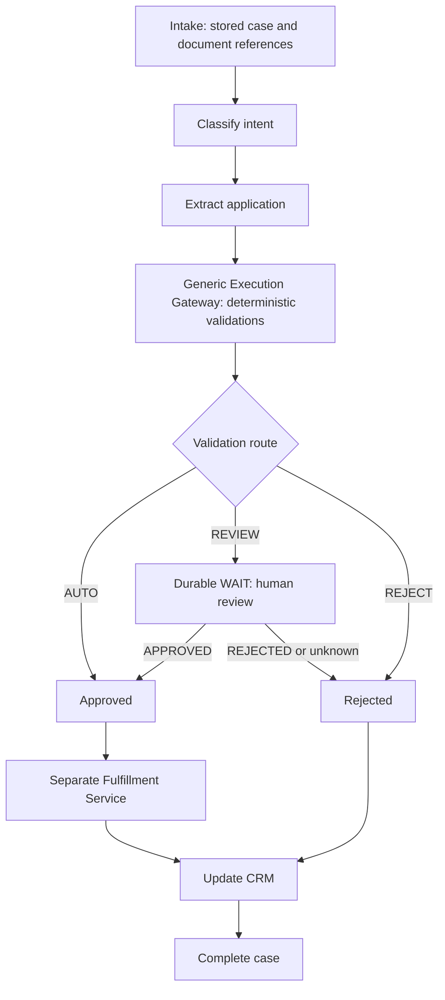

# Conductor OSS AAO proof of concept

Small self-hosted Python demo using **conductor-oss/conductor v3.32.5** and the
official **conductor-python 1.5.1** SDK. No existing application or API conventions
were present. This adds a CLI rather than a new web platform. There is no AWS
provisioning and no connection to banking systems.

## Implemented workflow

`workflows/aao-v1.json` is the versioned journey definition. Conductor owns
execution state, order, branches, retries, timeouts, and review waits. Python
workers call service interfaces; they do not run the journey themselves.



Input is `case_id` and `document_refs`. Classification output supplies intent;
extraction supplies application data; validation returns `AUTO`, `REVIEW`, or
`REJECT` plus errors. Approval alone enables fulfillment. Fulfillment output
supplies the account reference to CRM and case completion. Workflow output is
`case_id`, `outcome`, `account_id`, and `validation_errors`. A business rejection
is a successfully **COMPLETED** execution with outcome **REJECTED**. Worker
errors and exhausted retries instead fail or time out the execution.

| Worker task | Boundary / local behavior |
| --- | --- |
| `aao_classify_intent` | IntentService; reads a synthetic fixture's intent |
| `aao_extract_application` | ExtractionService; reads structured JSON, no OCR |
| `aao_validate` | ExecutionGateway delegates `validate_aao` to ValidationService |
| `aao_fulfill` | FulfillmentService; records a synthetic account in SQLite |
| `aao_update_crm` | CrmService; records final decision/account in SQLite |
| `aao_complete_case` | CaseService; records the completed case in SQLite |

Validation only checks required fields, supported account type, current mock
KYC, and a boolean review flag. Unsupported intent is rejected. These are demo
rules, not bank policy. Fixture references resolve to exactly one JSON file in
the configured document directory. Intake is simulated by pre-existing fixtures
and the `start` command; there is no upload or case-storage API.

## Local run

Requirements: Python 3.10+ (verified here on 3.13), Git, Docker with Compose v2,
and resources for the upstream server build, Redis, and Elasticsearch. Run all
commands from this repository root. PowerShell examples:

```powershell
python -m venv .venv
.\.venv\Scripts\python -m pip install -r requirements.lock.txt
.\.venv\Scripts\python -m pip install -e .
```

The runtime dependency file pins the resolved transitive versions. The package
also pins the SDK in `pyproject.toml`. Optional equivalent with uv:

```powershell
uv venv .venv
uv pip install --python .venv/Scripts/python.exe -r requirements.lock.txt
uv pip install --python .venv/Scripts/python.exe -e .
```

Build the community OSS server from its release tag using the upstream Compose
distribution. This avoids assuming an unverified published container tag:

```powershell
git clone --branch v3.32.5 --depth 1 https://github.com/conductor-oss/conductor.git .conductor-oss
docker compose -p aao-demo -f .conductor-oss/docker/docker-compose.yaml -f compose.local.yaml up --build -d
Invoke-WebRequest http://localhost:8000/health
```

The [tagged upstream Compose file](https://github.com/conductor-oss/conductor/blob/v3.32.5/docker/docker-compose.yaml)
builds the server and pins Redis to `6.2.3-alpine` and Elasticsearch to `7.17.11`.
It selects the Redis configuration and exposes API port 8000 and UI port 8127.
The local overlay enables Redis AOF and a named volume, preserving local state
and queues across container restarts. Elasticsearch already uses an upstream
named volume. Do not use `down -v` if you want to retain local workflow state.
Redis's one-second AOF flush is a development durability choice, not a banking
recovery guarantee. This development stack has no authentication; operate it on
an isolated development machine.

The first startup can take over a minute (about 80 seconds observed locally).
During startup, `/health` can close the connection before the HTTP listener is
ready. Check readiness with:

```powershell
docker compose -p aao-demo -f .conductor-oss/docker/docker-compose.yaml -f compose.local.yaml ps
```

If Conductor fails to start with an Elasticsearch `Connection refused` error,
wait for Redis and Elasticsearch to show `healthy`, then restart only the server:

```powershell
docker compose -p aao-demo -f .conductor-oss/docker/docker-compose.yaml -f compose.local.yaml restart conductor-server
```

Wait for the server to show `healthy` before retrying `/health`. Dependency
ordering at `compose up` does not guarantee that dependencies are ready after a
Docker engine restart. Detailed Java startup logs are also available with
`docker exec conductor-server tail -n 100 /app/logs/server.log`; upstream Docker
log rotation retains only very small logs.

To use an existing self-hosted OSS server instead, set its `/api` URL:

```powershell
$env:CONDUCTOR_SERVER_URL = 'http://localhost:8000/api'
.\.venv\Scripts\aao register
.\.venv\Scripts\aao workers
```

Keep the worker command running. In another terminal:

```powershell
.\.venv\Scripts\aao start --case-id demo-auto-001 --document-ref fixture:automatic.json
.\.venv\Scripts\aao status <workflow_id>

.\.venv\Scripts\aao start --case-id demo-review-001 --document-ref fixture:review.json
.\.venv\Scripts\aao status <workflow_id>
.\.venv\Scripts\aao review <workflow_id> --decision APPROVED --reviewer synthetic-reviewer-1
.\.venv\Scripts\aao status <workflow_id>

.\.venv\Scripts\aao start --case-id demo-reject-001 --document-ref fixture:review.json
.\.venv\Scripts\aao review <workflow_id> --decision REJECTED --reviewer synthetic-reviewer-1

.\.venv\Scripts\aao start --case-id demo-invalid-001 --document-ref fixture:invalid.json
```

Replace `<workflow_id>` with the ID returned by the corresponding start. For
review commands, wait until status shows `human_review` as `IN_PROGRESS`.
Each new application must have a new case ID. Reusing an existing case ID for
different input is an idempotency conflict. `correlationId` associates the
workflow with the case but does **not** deduplicate workflow starts. A real intake
service must durably record the workflow ID and reconcile ambiguous start
responses rather than blindly creating duplicate executions.

Global `--url` goes before the subcommand. Workers accept `--documents`,
`--ledger`, and `--worker-id`. Defaults use `examples/documents` and
`.local/effects.sqlite3`; all demo workers must share the same SQLite file to
share mock idempotency. Run from source without installing the project by
setting `$env:PYTHONPATH = 'src'` and replacing `aao` with
`.\.venv\Scripts\python -m conductor_demo.cli`.

Stop the server with:

```powershell
docker compose -p aao-demo -f .conductor-oss/docker/docker-compose.yaml -f compose.local.yaml down
```

### If the server build ends with `error reading from server: EOF`

This indicates that the build client lost its connection to the builder; it
does not by itself identify a Java compilation error. Check `docker info` and
Docker Desktop's diagnostics. The upstream source build allows a 2 GiB Gradle
heap and a 4 GiB UI heap, so a roughly 4 GiB Docker VM can encounter memory
pressure. Keep build cache and the downloaded images for the retry.

For this CLI-based demo, the pinned Dockerfile supports skipping the UI build:

```powershell
docker compose --progress plain -p aao-demo -f .conductor-oss/docker/docker-compose.yaml -f compose.local.yaml build --build-arg SKIP_UI=true conductor-server
docker compose -p aao-demo -f .conductor-oss/docker/docker-compose.yaml -f compose.local.yaml up -d --no-build
Invoke-WebRequest http://localhost:8000/health
```

This retains the API, workflows, and Python workers; the web UI is unavailable
in this image. The Java server still builds from the pinned OSS source tag.
For the full UI build, increase the Docker/WSL VM memory allocation if host
capacity permits (8 GiB is a practical starting point), then retry the original
build. If another EOF occurs, capture the last build steps from `--progress
plain` and Docker Desktop diagnostics to distinguish resource exhaustion from
an engine crash or transport problem.

## Durable review and retries

The untimed `WAIT` task remains `IN_PROGRESS` until an external task update.
No worker polls `human_review`. Worker processes may stop and restart while it
waits; workflow state lives on the server. `review` loads the workflow, verifies
AAO v1 and the pending WAIT, then uses `POST /api/tasks` with the exact task ID,
`COMPLETED`, and output `{decision, reviewer}`. The subsequent workflow branch
permits fulfillment only for `APPROVED`; rejection bypasses fulfillment.
Reviewer references persist in the task output.

A repeated identical decision is a no-op; a conflicting decision, early review,
or review of a timed-out workflow is rejected. These checks cover **sequential**
CLI use. They are not a compare-and-set operation: simultaneous reviewers can
race. A real review API must authenticate and authorize reviewers, serialize
decisions per review task, persist its audit/decision record, and reconcile
ambiguous task-update responses. The CLI is a local signal adapter, not that API.
If a task-update response times out or reports a server error, the CLI checks the
review task again and recognizes an already committed matching decision. It
does not blindly resend the decision.

SIMPLE tasks have 60-second execution and 30-second response timeouts, fixed
two-second retry delays, and two retries for classification/extraction/validation
or three for side effects. Invalid input yields `FAILED_WITH_TERMINAL_ERROR`;
transient service errors yield `FAILED`. Acknowledgement failures are left for
Conductor redelivery. SDK calls use ten-second request timeouts. Workers are
single-process polling loops with bounded local handlers; real service adapters
need their own request timeouts and must return within the task deadline.

The workflow has a seven-day `TIME_OUT_WF` deadline, including human review.
Timeout does not mean rejection, and this demo does not automatically repair
the case or reverse an already fulfilled account after a later CRM failure.
Production needs reconciliation, alerting, and any bank-approved compensation
or manual recovery policy.

Keys are `aao:<case_id>:fulfill`, `aao:<case_id>:crm`, and
`aao:<case_id>:complete`. They remain stable across task attempts and workflow
duplicates. SQLite atomically stores the synthetic effect and result under a
unique key, with canonical input comparison and transaction locking. Duplicate
deliveries return the original result; changed payloads fail. Fulfillment,
CRM, and case completion have separate interfaces and records.

For real services, send these keys with each request and require service-side
atomic deduplication/result replay. A local ledger cannot atomically commit a
remote bank operation; a crash between remote success and a local record can
duplicate the remote operation unless that service honors the key. The SQLite
adapter is only for local mock effects, not distributed production workers.

## Checks

### Guided notebook (recommended for understanding the scenarios)

Open `notebooks/AAO_walkthrough.ipynb` in VS Code. Install the optional kernel
once if needed:

```powershell
uv pip install --python .venv/Scripts/python.exe -r requirements-notebook.txt
```

Choose the project's `.venv` using **Select Kernel → Python Environments**.
Keep Conductor running and stop any separate `aao workers` terminal. Run the
notebook cells from top to bottom with **Shift+Enter**, or use **Run All**.
The notebook runs local workers itself and shows readable result tables for
each case, the durable review pause, both human decisions, invalid KYC, a
four-scenario summary, and duplicate/conflicting review behavior. No workflow
IDs need to be copied. Setup creates a new session; rerunning scenario cells
reuses their workflow. Results use the persistent CLI mock ledger.
All 11 notebook code cells were executed successfully against the local server,
including the four scenarios, duplicate/conflicting decisions, and focused tests.

### Command-line checks

```powershell
.\.venv\Scripts\python -m unittest discover -s tests -v
.\.venv\Scripts\python -m compileall -q src tests tools
git diff --check

# Opt-in: server must be healthy; this registers definitions and creates synthetic cases.
.\.venv\Scripts\python tools/smoke.py
```

The focused tests cover workflow mappings/branch outcomes, review decisions,
concurrent and restarted side effects, failure reporting, and actual SDK
serialization/routes with an HTTP mock transport. The mapping interpreter is
a test helper, **not** a Conductor emulator or durability test. The live smoke
script exercises automatic approval, durable review with worker reconstruction,
approval, rejection, and invalid applications against a local server.

Verification in this workspace: **27 tests passed**; source compilation,
`git diff --check`, editable package installation, and the `aao --help` entry
point passed. All 22 locked runtime versions match installed distributions.
The local source-built server is now running and `/health` returned HTTP 200
with `healthy: true`. All four live smoke scenarios passed: automatic approval,
human approval, human rejection, and invalid-application rejection. The review
scenarios reconstructed workers/client while the durable WAIT was pending.
The CLI reconciles committed review decisions after ambiguous responses. SDK
serialization/routes were also tested with mocked HTTP, and server task/API
behavior was checked against tagged v3.32.5 source.

## Verified official references

- [Official SDK 1.5.1 distribution](https://pypi.org/project/conductor-python/1.5.1/)
  and [community SDK repository](https://github.com/conductor-oss/python-sdk).
  `Configuration`, generated resource APIs, `StartWorkflowRequest`, and
  `TaskResult` were inspected from the installed pinned distribution. The
  adapter uses baseline metadata, workflow start/status, task poll/update APIs;
  no Orkes SaaS authentication, proprietary human task, or newer signal API.
- [WAIT implementation at v3.32.5](https://github.com/conductor-oss/conductor/blob/v3.32.5/core/src/main/java/com/netflix/conductor/core/execution/tasks/Wait.java)
  and [WAIT documentation](https://conductor-oss.github.io/conductor/documentation/configuration/workflowdef/systemtasks/wait-task.html).
- [SWITCH mapper](https://github.com/conductor-oss/conductor/blob/v3.32.5/core/src/main/java/com/netflix/conductor/core/execution/mapper/SwitchTaskMapper.java),
  [value-param evaluator](https://github.com/conductor-oss/conductor/blob/v3.32.5/core/src/main/java/com/netflix/conductor/core/execution/evaluators/ValueParamEvaluator.java),
  and [SET_VARIABLE implementation](https://github.com/conductor-oss/conductor/blob/v3.32.5/core/src/main/java/com/netflix/conductor/core/execution/tasks/SetVariable.java).
- [Task definitions and timeout fields](https://github.com/conductor-oss/conductor/blob/v3.32.5/common/src/main/java/com/netflix/conductor/common/metadata/tasks/TaskDef.java),
  [workflow fields](https://github.com/conductor-oss/conductor/blob/v3.32.5/common/src/main/java/com/netflix/conductor/common/metadata/workflow/WorkflowDef.java),
  [task fields](https://github.com/conductor-oss/conductor/blob/v3.32.5/common/src/main/java/com/netflix/conductor/common/metadata/workflow/WorkflowTask.java),
  [task REST endpoints](https://github.com/conductor-oss/conductor/blob/v3.32.5/rest/src/main/java/com/netflix/conductor/rest/controllers/TaskResource.java),
  and [workflow REST endpoints](https://github.com/conductor-oss/conductor/blob/v3.32.5/rest/src/main/java/com/netflix/conductor/rest/controllers/WorkflowResource.java).

The legacy `com.netflix.conductor` Java package names in community OSS source
do not change the target repository: this demo targets `conductor-oss/conductor`.

## Missing integrations and AWS operating components

None of these are provisioned or implemented beyond the local interfaces:

| Component | Required integration / operation |
| --- | --- |
| Intake and Platform SDK | Case/document persistence, workflow start/status contract, durable case/workflow association, start reconciliation |
| Document storage and extraction | Secure document references/storage, extraction and intent APIs; fixtures currently replace both |
| Generic Execution Gateway | Authenticated execution contract, policy/rule versions, bounded requests, Validation Services delegation |
| Validation Services | Actual deterministic bank rules and independently deployable services |
| Fulfillment Services | Separate account-opening API, stable idempotency keys, replay and reconciliation |
| CRM and case services | Real update/completion APIs with deduplication and error recovery |
| Human review | Authorized review UI/API, decision serialization, audit trail, notifications/escalation |
| Server and workers | ECS/Fargate or EKS compute, independently scaled workers, pinned deployment artifacts and workflow version rollout |
| Durable storage/queues | Select and validate a backend supported by this OSS release; operate Redis-compatible persistence/queues for this configuration with backup/restore and recovery testing |
| Search/indexing | Operate a compatible Elasticsearch backend for this configuration; verify any proposed managed service/version compatibility |
| Networking and security | Private VPC/subnets, security groups, TLS ingress/internal load balancer, server API access controls and worker/service authorization |
| Secrets and monitoring | Secrets Manager or equivalent, IAM roles, CloudWatch/OpenTelemetry logs/metrics, failed-task/timeout/queue-lag alerts, PII retention/access controls |

Do not use the local unauthenticated Compose stack or SQLite mock adapters as a
production deployment. Credentials belong in runtime secret injection, never
workflow definitions. This adapter explicitly disables the SDK's automatic
Orkes credential discovery; production OSS authentication must match the
selected deployment's supported access layer. No bank endpoints are assumed.
